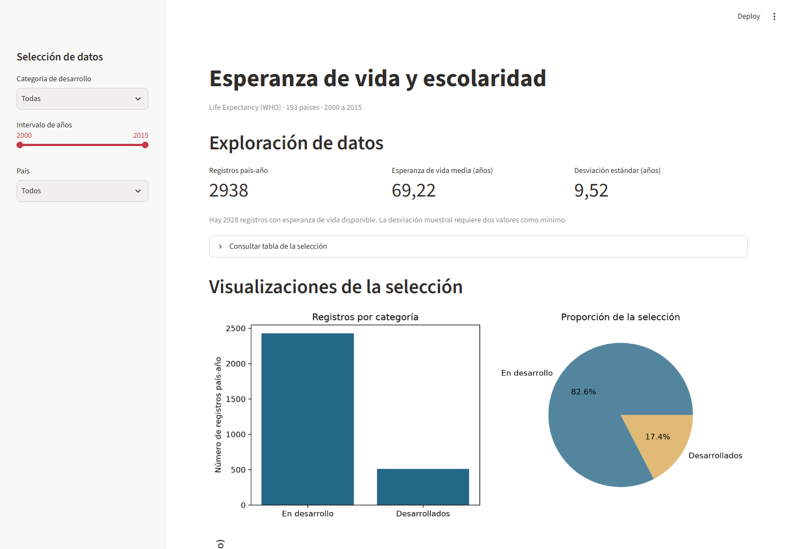

# Esperanza de vida y escolaridad

Dashboard de la Tarea 4 para explorar las diferencias de esperanza de vida que recoge el EDA de la Tarea 3. Cada fila corresponde a un país en un año entre 2000 y 2015.

Se eligió Life Expectancy (WHO), versión 1 de [kumarajarshi en Kaggle](https://www.kaggle.com/datasets/kumarajarshi/life-expectancy-who), por su cobertura temporal y sus indicadores educativos y sanitarios. La copia local conserva los bytes del análisis original. La app verifica su huella al cargarla.



## Hallazgos

- La esperanza de vida media fue 69,22 años entre las filas con información disponible.
- En 2015 hubo una diferencia media de 11,02 años entre las dos categorías de desarrollo.
- La escolaridad y la esperanza de vida presentan una asociación positiva en 2.768 pares disponibles.
- En el panel completo de 183 países la media pasó de 66,75 a 71,62 años.

## Ejecución

Con Python 3.12, la aplicación usa la copia local del CSV cuando está disponible y, en su ausencia, descarga la versión 1 desde Kaggle y verifica su huella. Desde esta carpeta ejecute:

```sh
python -m pip install -r requirements.txt
python -m streamlit run app.py
```


Alvaro Daniel Ahumada Navarro · Grupo 08 · Programación para el Análisis de Datos (203008069) · UNAD · 23 de noviembre de 2026.
